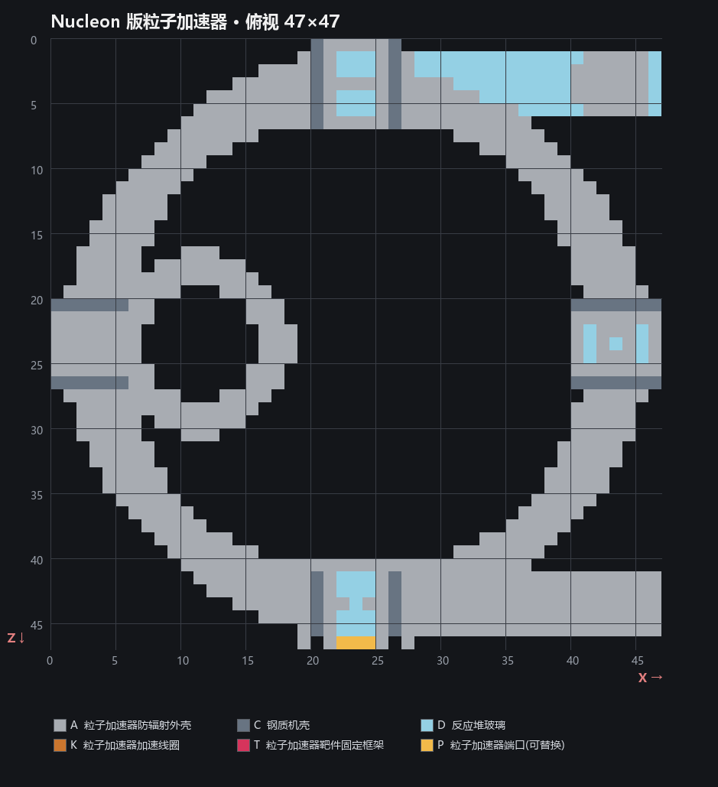
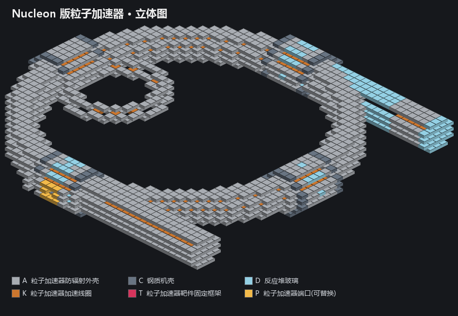
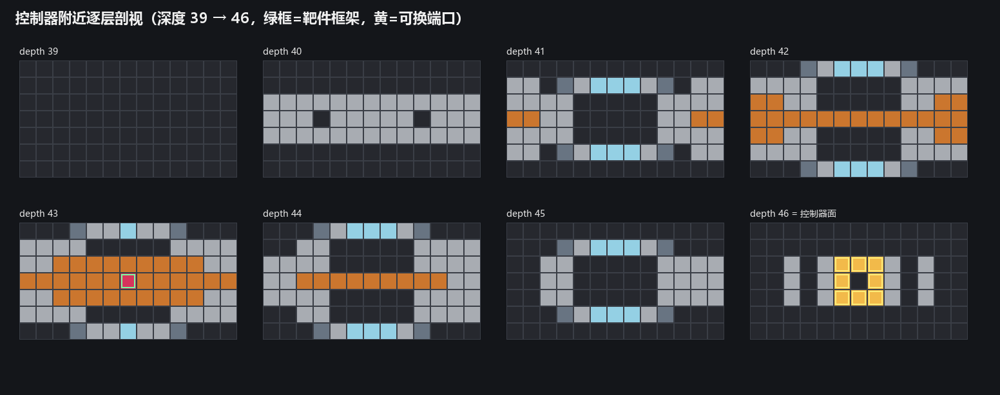

# 粒子加速器多方块结构（Nucleon 版）

沿用 GTQT「大型环形粒子对撞研究复合体」的骨架，把方块全部换成 Nucleon 自己的材料，
并按需求加入了 **控制器正面 3×3 端口区**、**控制器后方第 3 格靶件框架**，
以及完整的端口模式、内部缓存、配方、GUI、JEI 和运行音效。

## 1. 方块映射

| 原结构（GTQT） | 现在（Nucleon） | 说明 |
|---|---|---|
| 加速器外壳 | `meknuc:particle_accelerator_radiation_resistant_casing` 粒子加速器防辐射外壳 | 环体、端口外墙、束流管外壳 |
| 钠夸达框架 | `mekanism:steel_casing` 钢质机壳 | 四个端口的边框 |
| 强化玻璃 | `mekanismgenerators:reactor_glass` 反应堆玻璃 | 观察窗、束流管玻璃段 |
| 加速器电磁轭 | `meknuc:particle_acceleration_coil` 粒子加速器加速线圈 | 环体中心的磁轭 |
| 加速器束流管 / 粒子探针 | 同上，加速线圈 | 两条束流管内部、核合成小环 |
| 控制器 | `meknuc:particle_accelerator_controller` 粒子加速器控制器（新增） | 结构锚点 |
| —— | `meknuc:particle_accelerator_target_mounting_frame` 靶件固定框架 | 控制器后方第 3 格 |

> 钢质机壳和反应堆玻璃是原版 Mekanism 的方块，不是多方块方块，这点见「已知限制」。

## 2. 尺寸与形状

- 占地 **47 × 47**，高度 **7**：平躺的大圆环（甜甜圈），不是立环。
- 主环：外径约 43、内孔 33、环带宽 5、环体高 5。
- 环体截面 5×5（削角），中间是 3×3 的加速线圈芯。
- 四个正方向各一个 7×7×7 端口段：钢质机壳包边 + 反应堆玻璃窗。
- +X 侧（相对控制器面朝外时）伸出两条平行的 5×5 束流管，末端分别是靶室与束流段。
- 环孔西侧悬着一个直径约 13 的小环（核合成环）。

## 3. 控制器与两条额外规则

**控制器**：放在环体最外壁上（原 GT 结构里控制器所在的那一格），放置时**正面朝向玩家**，
整台机器向控制器背后展开 46 格。控制器上方/下方各 3 格、左右各 23 格。

> 锚点与 GTQT 完全一致：图案坐标 `(23, 3, 46)`，也就是南侧端口外壁的正中；
> 结构文件 `particle_accelerator.nbt` 里控制器也放在这一格（`facing=south`）。

控制器贴图取自 `桌面/反应堆/粒子加速器控制器.bbmodel` 内嵌的 64×64 贴图；
UV 已换算成模型格式，并把带绿色屏幕的那一面放到模型正面（north），其余五面用外壳板。
这样无论控制器朝哪边放，屏幕都正对玩家。

**规则 1：3×3 端口区**
只有控制器所在的那一面、以控制器为中心的 **3 × 3** 范围内，防辐射外壳可以替换成
`particle_accelerator_port`（端口）；这 8 个位置以外的任何端口方块都会导致结构判定失败。

**规则 2：靶件固定框架**
控制器背后第 **3** 格（沿结构展开方向）必须是 `particle_accelerator_target_mounting_frame`
靶件固定框架，这一格原来在 GT 结构里是环体线圈。

## 4. 建造顺序建议

1. 先放控制器，确认它的正面朝外，记下背后方向。
2. 以控制器为中心铺 47×47 的环：外壳 + 中间线圈 + 四个端口的钢质机壳边框和玻璃。
3. 两条束流管从 +X 侧（面向控制器时的右手边）平行伸出。
4. 环孔西侧补上核合成小环。
5. 控制器背后第 3 格换成靶件固定框架。
6. 需要端口时，只在控制器那一面的 3×3 内替换外壳。

> 结构跨 3×3 个区块，建造时确保整片区域已加载。

## 5. 端口模式

端口放置后默认是「输入粒子束」，**潜行 + 右键** 循环切换模式（也有对应的端口模型）。

> 控制器本身也直接暴露**靶材输入 / 输出槽**（和 GUI 里那两个槽是同一个），
> 物品管道可以直接接在控制器上把靶材送进机器、把成品抽走；控制器**不**暴露化学品缓存，
> 氢气与等离子体仍然只通过端口进出。

| 模式 | 作用 |
|---|---|
| 输入粒子束 | 向内部按化学品分开的缓存输入粒子束化学品（氢气 / 热质子等离子体 / 热中子等离子体） |
| 输出粒子束 | 只导出已经加工好的热质子 / 热中子等离子体（不会抽走氢气），把管道接在这里取走产物 |
| 输入能量 | 只向内部能量缓存输入 FE；缓存满后自动停止输入 |
| 输入靶材 | 向靶材输入槽输入物品，且只接受配方指定的物品 |
| 输出靶材 | 从靶材输出槽抽取加工完成的物品 |

内部设定：

- 能量缓存上限 **16 GFE**（16,000,000,000 FE），装满能量升级后提升到 **160 GFE**。输入满后拒绝继续输入，被消耗后自动恢复输入。
- 输入缓存：氢气上限 **128,000 mB**，被配方消耗后自动恢复输入。
- 产物缓存：热质子 / 热中子等离子体各 **64,000 mB**；某种产物缓存满了以后，产出它的配方停止运行
  （顶部显示「输出缓存已满」），直到通过「输出粒子束」端口把产物导出一部分后自动继续。
- 靶材输入槽只接受配方表里出现过的物品；输出槽只能抽取，不能反向输入。
- 能量端口只允许输入；机器内部逻辑可以从缓存中抽取能量。

## 6. 工作模式与配方

**不再需要手动选择配方**：机器每 tick 在当前模式里自动寻找第一条可以运行的配方并直接开始。
处理时间单位为 tick（20 tick = 1 秒），能耗单位为 FE/t，1 MFE = 1,000,000 FE。

界面底部有两个模式按钮：**粒子加速** / **束流收集**。切换模式会放弃当前这一份已投入的材料。

### 6.1 束流收集模式

把氢气或铀-238粉转换成等离子体，产物进入对应的 64,000 mB 产物缓存，可以从「输出粒子束」端口抽走；
产物缓存满了就停机等待导出。

| 靶材输入 | 粒子束输入 | 产物 | 处理时间 | 能耗 |
|---|---|---|---|---|
| —— | 10,000 mB 氢气 | 1,000 mB 热质子等离子体 | 200 t（10 s） | 10 MFE/t |
| 1 铀-238粉 | —— | 1,000 mB 热中子等离子体 | 200 t（10 s） | 15 MFE/t |

### 6.2 粒子加速模式

靶材 + 热质子 / 热中子等离子体 -> 新的靶材或物品。

| 靶材输入 | 粒子束输入 | 产物 | 处理时间 | 能耗 |
|---|---|---|---|---|
| 1 铀-233粉 | 1,000 mB 热中子等离子体 | 1 铀-235粉 | 100 t（5 s） | 25 MFE/t |
| 1 铀-238粉 | 1,000 mB 热质子等离子体 | 1 钚-239粉 | 400 t（20 s） | 50 MFE/t |
| 1 富集碳 | —— | 1 钻石粉 | 20 t（1 s） | 10 MFE/t |
| 1 钚-239粉 | 1,000 mB 热质子等离子体 | 1 镅-241粉 | 100 t（5 s） | 65 MFE/t |
| 1 铅粉 | 10,000 mB 热质子等离子体 + 10,000 mB 热中子等离子体 | 1 钋-210粉 | 1,200 t（60 s） | 100 MFE/t |
| 1 钍粉 | 1,000 mB 热质子等离子体 | 1 钌粉 | 200 t（10 s） | 45 MFE/t |
| 1 锡粉 | 1,000 mB 热质子等离子体 | 2 铁粉 | 1 t | 10 MFE/t |
| 100 钋粉 | 10,000 mB 热质子等离子体 + 10,000 mB 热中子等离子体 | 1 反物质球 | 4,800 t（240 s） | 200 MFE/t |

JEI 中使用「粒子加速器」分类显示以上配方，左侧列为靶材与 1~2 种等离子体，右侧为成品
（物品或等离子体），分类图标取自桌面 `JEI图标/粒子加速器图标.bbmodel` 内嵌的 16×16 图标。

自动运行规则：

1. 当前模式里，**优先运行靶材槽里放着的物品对应的配方**（束流收集模式下只要槽里有铀-238粉，
   就会先做「铀-238 → 热中子等离子体」，不会被只吃氢气的第一条配方一直占住）；
2. 没有靶材时沿用上一条仍在运行的配方，再按配方表顺序找第一条满足「靶材 / 等离子体 / 输出空间 / 能量」的配方；
3. 找到后一次性扣掉靶材与全部等离子体，每 tick 扣能量并推进进度；
4. 中途缺能量会原地暂停，补上后继续，不会丢失已投入的材料；
5. 当前模式里没有任何可运行配方时，顶部状态显示具体缺少的条件（缺材料 / 缺等离子体 / 输出已满 / 能源不足），
   一条都匹配不上时显示「未检测到可运行配方」。

### 6.3 速度 / 能量升级

控制器方块支持 **速度升级** 与 **能量升级**（各最多 8 级，上限与 Mekanism 单方块机器一致）。
升级窗口是 Mekanism 标准面板：把升级放进控制器 GUI 的升级窗口，或潜行右键控制器直接装入。

效果沿用 Mekanism 的通用公式（`maxUpgradeMultiplier` 默认 10，`s` = 速度等级、`e` = 能量等级）：

| 项目 | 公式 | 8 级时 |
|---|---|---|
| 处理时间 | 基准 tick × 10^(-s/8) | 缩短到 1/10（如 200 t → 20 t） |
| 每 tick 能耗 | 基准 FE/t × 10^(2s/8 - e/8) | 速度满级 ×100，能量满级 ÷10 |
| 内部缓存上限 | 16 GFE × 10^(e/8) | 160 GFE |

- 速度升级会按平方关系抬高维持功率：满速度 + 满能量时每 tick 耗电为基准的 10 倍、单件产物总耗电与基准相同。
- 拆掉能量升级后，超出新上限的储能会被直接截断到新上限。
- 能量缓存上限与实时能耗都通过容器同步到 GUI，能量条会按升级后的容量显示。

## 7. GUI

成形后右键控制器打开（空手或手持物品均可）。界面使用 Mekanism 标准机器底图、内嵌屏幕、
竖向能量条、动态进度条、标准槽位和按钮：

- **左侧**：内部能量缓存竖条（16 GFE 起，随能量升级提升），悬停显示精确 FE 数值。
- **中上**：运行状态（待机 / 运行中 / 缺少材料 / 缺少等离子体 / 能源不足 / 输出槽已满 / 未检测到可运行配方）。
- **中间**：自动检测到的配方的「输入 → 输出」、实时能耗（FE/t）和进度条。
- **右侧**：粒子束缓存，按 **氢气（128,000 mB）、热质子等离子体（64,000 mB）、热中子等离子体（64,000 mB）** 从上往下排列，
  显示名称与 mB 数量；悬停显示当前量 / 容量。
- **右下**：靶材输入 / 输出槽（也可以从端口用管道进出）。
- **底部**：「粒子加速」与「束流收集」两个模式按钮，当前模式的按钮显示为绿色。

## 8. 运行音效

运行音效来自 `下载/粒子对撞机两分钟白噪音 [BV1cHQ1B4EWE_p1].mp3`，
已转成 Ogg Vorbis 放在 `assets/meknuc/sounds/particle_accelerator_running.ogg`，
只在多方块主方块（控制器）且配方正在推进时循环播放。
原始音频峰值只有约 0.17（-16 dBFS），而 Minecraft 的音量上限固定在 1.0，
所以按需求把整段音频做了 **2.5 倍（约 +8 dB）** 的增益，峰值提升到约 0.42，听感上更响亮且不削波。
原始文件备份在 `build/tmp/particle_accelerator_running.orig.ogg`。

## 9. 代码结构

新增（`src/main/java/meknuc/particle/`）：

| 文件 | 作用 |
|---|---|
| `MeknucParticleAcceleratorMultiblock` | 多方块管理器（`MultiblockManager`），使用专用缓存 |
| `MeknucParticleAcceleratorMultiblockData` | 能量 / 粒子束缓存、靶材槽、配方进度与状态、速度 / 能量升级缩放 |
| `MeknucParticleAcceleratorCache` | 保存能量、化学品、物品、选中配方与进度 |
| `MeknucParticleAcceleratorRecipes` | 两种模式共 10 条配方，以及靶材 / 化学品过滤 |
| `MeknucParticleAcceleratorValidator` | 结构校验：逐格比对图案、3×3 端口、靶件位置 |
| `MeknucParticleAcceleratorPattern` | 47×47×7 的图案数据（字符表） |
| `MeknucParticleAcceleratorContainer` / `...ContainerTypes` | GUI 容器与注册 |
| `MeknucParticleAcceleratorLang` | GUI / JEI / 状态翻译键 |
| `MeknucParticleAcceleratorSounds` | 运行音效注册 |
| `tile/TileEntityParticleAcceleratorPart` | 结构方块实体（外壳/框架/线圈/端口） |
| `tile/TileEntityParticleAcceleratorController` | 控制器（`canBeMaster = true`，打开 GUI） |
| `tile/TileEntityParticleAcceleratorPort` | 端口（模式切换与能力暴露） |
| `blocks/BlockParticleAcceleratorController` | 控制器方块（带 `facing`） |

新增（客户端）：

- `client/gui/MeknucParticleAcceleratorGui`：能量条、状态、进度、粒子束列表、配方下拉列表。
- `client/jei/MeknucParticleAcceleratorJEICategory`：JEI 配方分类。

资源：

- `assets/meknuc/textures/jei/particle_accelerator.png`：JEI 分类图标。
- `assets/meknuc/sounds/particle_accelerator_running.ogg`：运行白噪音。
- `assets/mekanism/sounds.json`：音效事件定义。
- `assets/meknuc/lang/zh_cn.json` / `en_us.json`：GUI、状态、JEI、字幕文本。

## 10. 测试方法

**方式 A：测试功能（最快）**

创造模式下**潜行 + 右键控制器**：会先清空整个 47×7×47 包围盒（控制器本身保留），
再按图案把所有方块铺好，下一 tick 自动成形，聊天栏提示「粒子加速器结构已生成」。
包围盒里原有的其它方块都会被直接删除。

成形后**右键控制器**打开 GUI；把控制器所在 3×3 的若干外壳换成端口，
用配置工具或潜行右键切换成需要的模式。

**方式 B：结构方块**

1. 进创造模式，`/give @s minecraft:structure_block`
2. 结构方块设为「加载」，输入 `meknuc:particle_accelerator`，点加载
3. 整台机器（含控制器）会一次性放下，控制器默认朝南
4. 右键控制器：未成形时会触发一次结构检测并把失败原因发到聊天栏

**方式 C：手动搭建**

按第 4 节顺序搭，搭完右键控制器触发检测；
如果不能成形，聊天栏会给出第一处不匹配的坐标和方块。

## 11. 已知限制

- **钢质机壳和反应堆玻璃不是多方块方块**：数据类每 200 tick 只抽查几个特征方块
  （钢质机壳与靶件框架）。只有抽查点真的被破坏时才触发一次整环复检；结构正常时不会
  重置多方块数据，也不会关闭已打开的 GUI。反应堆玻璃等非抽查方块拆掉后，右键控制器可手动复检。
- 10 条配方目前直接写在代码里（`MeknucParticleAcceleratorRecipes`），没有做成数据包 JSON；
  如需整合包自定义，需要再改成 RecipeType + 数据包。
- 束流收集模式有化学品产物（热质子 / 热中子等离子体），产物直接进入对应的等离子体缓存，
  由「输出粒子束」端口对外抽取；缓存满时机器显示「输出槽已满」并暂停。